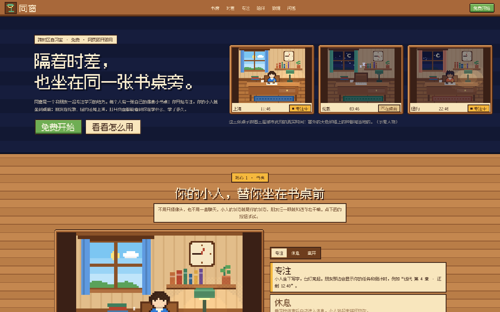
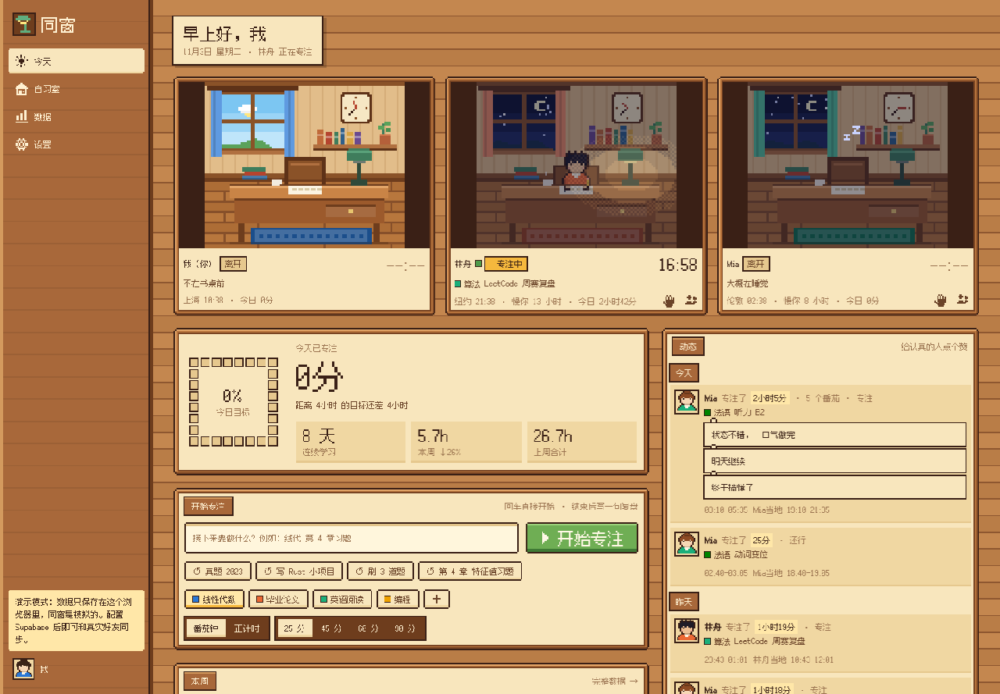
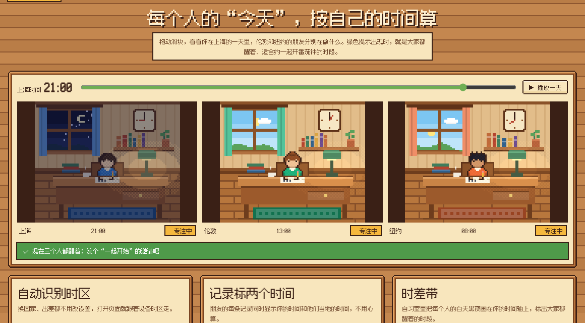
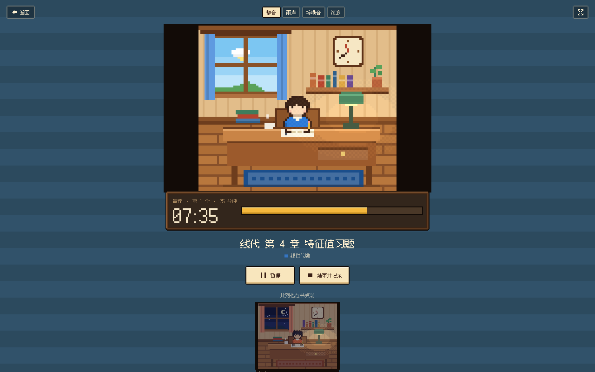
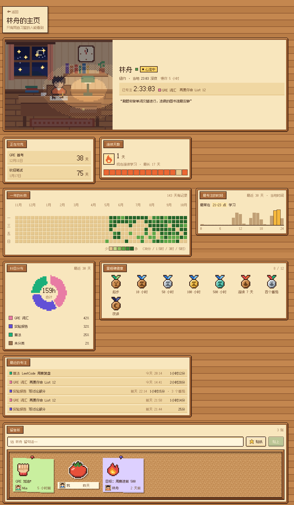
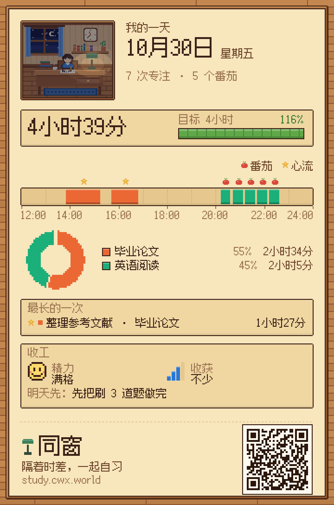
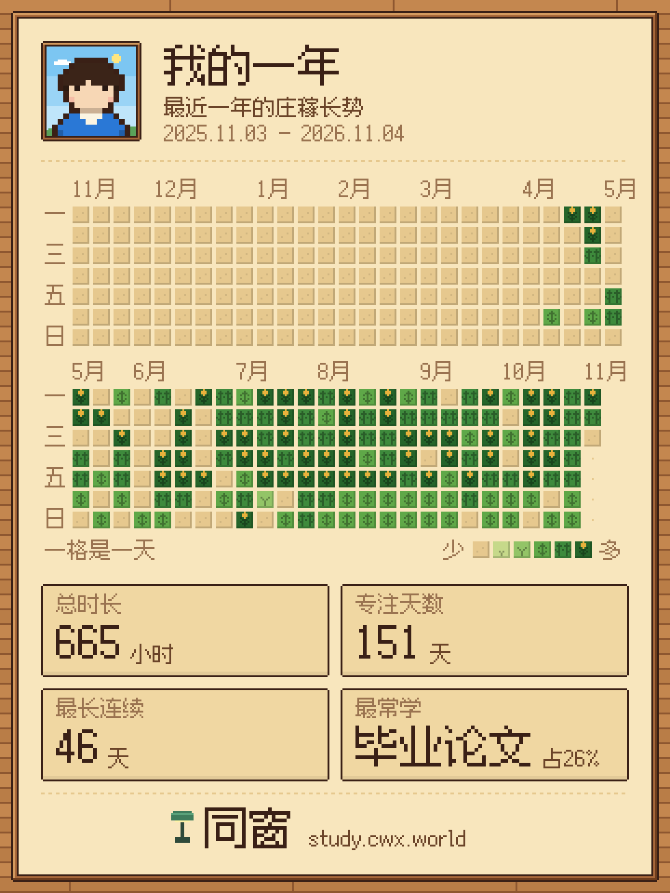
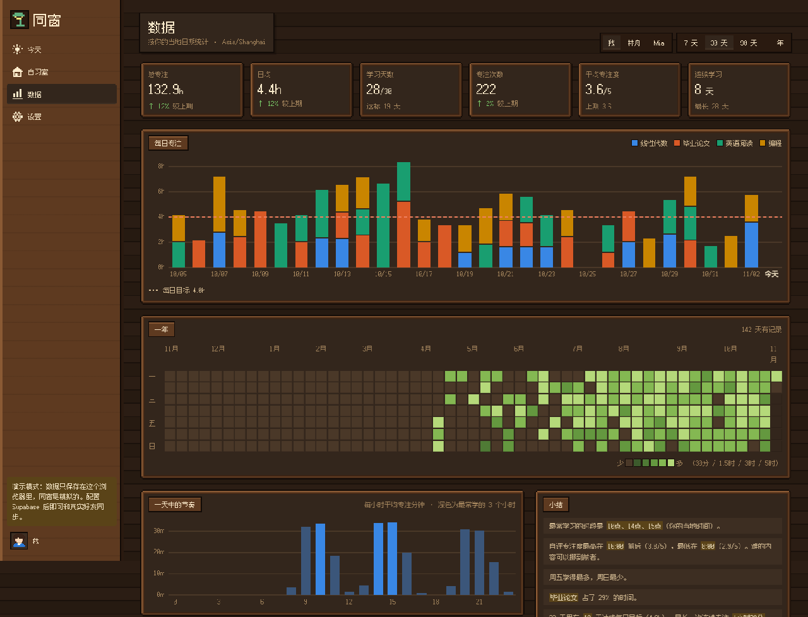
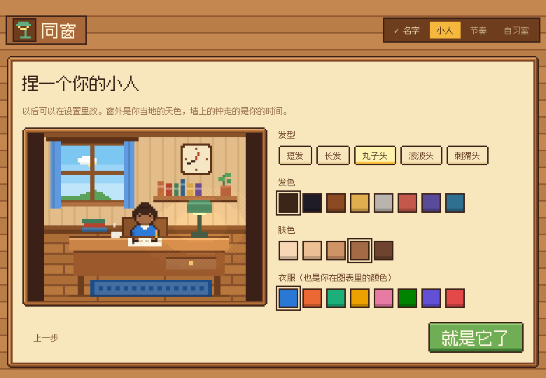
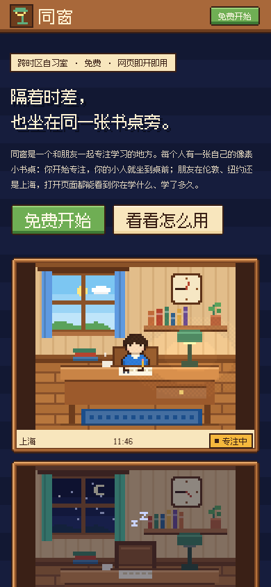

<div align="center">

# 同窗

**隔着时差，也坐在同一张书桌旁。**

和朋友一起专注学习的像素风自习室。每个人有一张自己的小书桌：你开始专注，你的小人就坐到桌前；<br>朋友在伦敦、纽约还是上海，打开页面都能看到你在学什么、学了多久。

[立即使用](https://study.cwx.world) · [产品介绍](https://study.cwx.world/release) · [更新日志](CHANGELOG.md) · [需求池](docs/BACKLOG.md)




</div>

## 它能做什么

### 书房：你的小人替你坐在书桌前

不用开摄像头，也不用一直聊天。专注时小人坐下写字、台灯亮起；休息时站起来喝水；离开时椅子空着。窗外是主人当地的天色，墙上的钟走的是主人当地的时间，深夜没人时房间会暗下来、飘出 Zzz。



### 时差：每个人的“今天”按自己的时间算

自动识别时区，连续天数和每日目标对每个人都公平。朋友的每条记录同时标出你的时间和他们当地的时间；自习室里的时差带会标出大家都醒着、适合一起开番茄钟的时段。



### 专注：三步完成一次有记录的专注

写下要做的事 → 选模式：番茄钟、心流（正计时，每满 25 分钟窗外亮一颗星，结束时建议休息多久）或倒计时（真实录音的环境声：雨、咖啡馆、壁炉、溪流、虫鸣、海浪、鸟鸣，可混合、可分别调音量；屏幕常亮，关掉页面不丢）→ 给专注度打分、写一句复盘。忘了点结束也没关系：时长可以改短，但不能改长。



### 状态与收工：不在书桌前，也让同窗知道

像微信状态一样挂一句“睡觉了”“上课中”“出去玩”，可以只挂 1 小时、到今晚 0 点或一直挂着；睡觉时书桌熄灯，小人趴在桌上。晚上点“收工”：回顾今天的时长和科目，给精力和收获打分，写下明天先做什么，第二天打开时会看到“昨天的你说”。

### 陪伴：不打扰，但彼此看得见

戳一下、邀请一起开番茄钟、给朋友的记录点 👏 🔥 💪。页面在后台时会弹出系统通知。

### 主页：给同窗看的自己

点任何头像或名字进入对方的主页：实时书桌、签名，以及主人自己挑选和排列的小组件，比如正在攻克的目标倒计时、里程碑徽章、一年的长势、科目分布、最近的专注。主页下方是留言板：同窗可以贴一张便利贴，写一句话或者贴一张像素贴纸。



### 数据：越记越想记

每日目标进度、连续天数、按科目分色的每日柱状图、一年的“庄稼长势”热力图、一天中最专注的时段、精力和收获的趋势、和同窗对比、自动小结。一年的热力图、某一天的记录和个人主页都能一键生成像素风长图，分享给自习室以外的朋友；图上的二维码通向同窗的介绍页。

<p align="center"> &nbsp; </p>

<table>
<tr>
<td width="62%"></td>
<td><br><br></td>
</tr>
</table>

## 技术栈

- **前端**：Next.js 15（App Router）+ React 19 + TypeScript，手写 CSS，无 UI 库
- **数据与实时**：Supabase（Postgres + 行级权限 + Realtime：数据变更订阅、在线状态、广播）
- **美术**：像素角色与房间在 `lib/pixel.ts` 里用代码绘制到 canvas；界面边框是 9 宫格像素图
- **字体**：[Fusion Pixel Font](https://github.com/TakWolf/fusion-pixel-font) 12px 简体中文（SIL OFL 1.1），按字符分片自托管
- **部署**：Vercel，推送到 `main` 自动上线

## 本地运行

```bash
npm install
```

```bash
npm run dev
```

不配置环境变量时进入**演示模式**：生成两位模拟同窗和几个月的示例数据，只保存在浏览器里，适合看效果和改界面。

## 部署

1. 在 [Supabase](https://supabase.com) 新建项目，在 SQL Editor 里执行 `supabase/schema.sql`。
2. 在 [Vercel](https://vercel.com) 导入本仓库，添加环境变量（项目首页的 Connect 按钮里能找到）：
   - `NEXT_PUBLIC_SUPABASE_URL`
   - `NEXT_PUBLIC_SUPABASE_ANON_KEY`（或 `NEXT_PUBLIC_SUPABASE_PUBLISHABLE_KEY`）
3. 绑定域名：Vercel → Settings → Domains 添加域名，在 DNS 加 CNAME 指向 `cname.vercel-dns.com`。如果域名在 Cloudflare，这条记录要设为 **DNS only**（灰色云朵）。
4. Supabase → Authentication → URL Configuration：Site URL 设为你的域名，并加入 Redirect URLs。
5. 有中国大陆的用户？按 [docs/china-access.md](docs/china-access.md) 把注册邮件改成验证码，并用 Cloudflare Worker 把数据请求转到自己的域名（`cloudflare/supabase-proxy.js`）。

## 更新与发版

版本号遵循[语义化版本](https://semver.org/lang/zh-CN/)：修 bug 升第三位（1.0.**1**），加功能升第二位（1.**1**.0），不兼容的大改升第一位。

**发一个新版本：**

1. 在 `lib/changelog.json` 最上面加一条：版本号、日期、标题、给用户看的更新内容；要改数据库时写上 `"migration": true`。
2. 把 `package.json` 的 `version` 改成同一个版本号。
3. 运行 `npm run changelog` 重新生成 `CHANGELOG.md`。构建前会自动检查这三处是否一致，不一致会直接构建失败。
4. 如果这个版本要改数据库，先在 Supabase SQL Editor 里重新执行一遍 `supabase/schema.sql`（脚本可以重复执行，不会丢数据）。
5. 提交并打标签，然后推送，Vercel 会自动部署：

```bash
git tag v1.1.0
```

```bash
git push origin main --tags
```

**用户那边会发生什么：**

- **开着页面的人**：每 10 分钟、以及切回这个标签页时，页面会问服务器当前的构建版本；发现变了就在底部提示“同窗更新到了 v1.1.0，刷新后生效”。正在进行的计时不受影响。
- **下次打开的人**：登录后弹一次“同窗更新了”，列出自上次以来的更新内容；关掉后这个版本不再弹出。
- **新用户**：不会弹更新公告。
- 设置页底部和产品主页底部都显示当前版本号，完整历史在产品主页的“更新日志”和 [CHANGELOG.md](CHANGELOG.md)。

## 目录结构

```
app/(main)/          今天、自习室、数据、设置（带侧边栏的页面）
app/focus/           全屏专注（番茄钟 / 心流 / 倒计时）
app/wrap/            收工（每日总结）
app/(main)/u/[id]/   个人主页（小组件、留言板）
app/welcome/         新手引导
app/release/         产品主页
app/api/version/     当前部署的版本号（给更新提示用）
components/          书桌场景、像素图标、图表、引导和更新组件
lib/backend/         数据层：supabase.ts（线上）与 demo.ts（演示），同一接口
lib/pixel.ts         像素角色与房间的绘制
lib/focus.tsx        计时引擎（刷新不丢，状态同步给同窗）
lib/focusModes.ts    三种专注模式与建议休息时长
lib/status.ts        个人状态（预设、有效期）
lib/review.ts        收工的“工作日”与熄灯判断
lib/shareKit.ts      分享图公用画法与二维码底部条
lib/shareCard.ts     一年热力图分享图
lib/dayCard.ts       一天的分享图
lib/profileCard.ts   主页分享图
lib/stats.ts         统计（按各自时区分日）
lib/changelog.json   版本与更新日志（唯一来源）
supabase/schema.sql  表结构、行级权限、实时订阅、记录只能改短的数据库约束
scripts/changelog.mjs 生成与校验 CHANGELOG.md
```

## 隐私与权限

只有和你在同一个自习室的人能看到你的资料、状态和记录；每个人只能修改自己的数据，且已保存的记录只能把时长改短。权限由数据库的行级安全策略保证，不依赖前端。

## 美术、字体与声音

- 角色、房间、图标都是为本项目原创绘制的像素画，没有使用任何游戏素材。
- 字体为 Fusion Pixel Font，遵循 SIL Open Font License 1.1，许可证见 `public/fonts/fusion12/OFL.txt`。
- 环境声为公有领域、CC0 与 CC BY 4.0 的真实录音（经 Blanket 项目整理），作者署名见 [`public/sounds/CREDITS.md`](public/sounds/CREDITS.md)，专注页的“音源署名”里也能看到。
